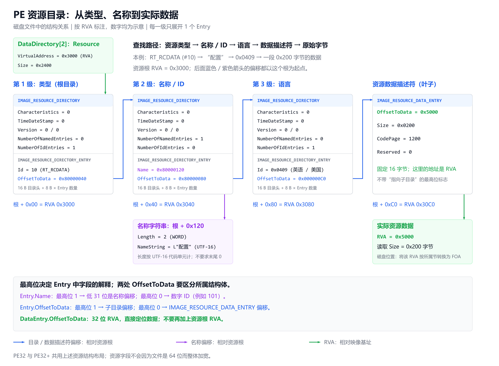

# PE 数据目录与资源目录结构

本文介绍 PE 可选头中的数据目录入口、资源目录结构和延迟导入的读取方式。功能进度与后续实现顺序见 [architecture.md](../architecture.md)。

## 数据目录入口

`IMAGE_OPTIONAL_HEADER32/64.DataDirectory` 是目录入口数组，每项都是 8 字节的 `IMAGE_DATA_DIRECTORY`：

| 偏移（字节） | 大小（字节） | 字段 | 含义 |
| --- | --- | --- | --- |
| 0 | 4 | `VirtualAddress` | 通常是目录起始 RVA；Security / Certificate 目录使用文件偏移。 |
| 4 | 4 | `Size` | 目录范围的字节数。 |

目录项提供位置和大小，具体内容由对应目录的格式决定。目录不一定从节的开头开始，也不能依赖 `.rsrc`、`.idata` 等节名定位。读取前还要检查 `NumberOfRvaAndSizes` 和可选头实际长度，不能假定文件一定提供全部 16 个入口。参见微软的[可选头数据目录规范](https://learn.microsoft.com/en-us/windows/win32/debug/pe-format#optional-header-data-directories-image-only)。

| 索引 | 目录 | 主要内容 |
| --- | --- | --- |
| 0 | Export 导出 | 导出目录头、地址表、名称与序号；EAT 项也可指向转发字符串。 |
| 1 | Import 导入 | DLL 描述符，以及描述符指向的 INT / IAT。 |
| 2 | Resource 资源 | 类型、名称 / ID、语言组成的树，以及资源数据描述符。 |
| 3 | Exception 异常 | 与目标架构相关的函数表和展开信息入口。 |
| 4 | Security / Certificate 证书 | 文件中的证书记录；入口地址是文件偏移。 |
| 5 | Base Relocation 基址重定位 | 重定位块和块内修复位置。 |
| 6 | Debug 调试 | 调试记录及载荷位置，例如 CodeView / PDB 信息。 |
| 7 | Architecture | 保留项，应为零。 |
| 8 | Global Ptr | 全局指针的特殊入口，Size 为零，不按普通记录表遍历。 |
| 9 | TLS | 线程局部存储目录和回调地址数组。 |
| 10 | Load Config 加载配置 | 随结构版本和 Size 扩展的加载配置字段。 |
| 11 | Bound Import 绑定导入 | 绑定导入描述符及转发引用记录。 |
| 12 | IAT 导入地址表 | 导入地址槽位的连续范围。 |
| 13 | Delay Import 延迟导入 | 延迟加载 DLL 的描述符及相关查找表 / 地址表。 |
| 14 | CLR Runtime Header | CLR 头部和元数据等入口。 |
| 15 | Reserved | 保留项，应为零。 |

Import Directory 从描述符组织“每个 DLL 导入什么”，IAT Directory 则给出 IAT 槽位的整体范围。`OriginalFirstThunk` 和 `FirstThunk` 位于导入描述符中；IAT Directory 本身没有这两个字段。导入页面可以通过描述符独立解析，不需要先取得 IAT Directory。

## Resource 资源目录

### 整体结构

资源目录通常按“类型 → 名称 / ID → 语言”三层组织。走到叶子后，先取得数据描述符，再根据描述符中的 RVA 和大小读取实际资源字节。三层是 Windows 的惯例，底层结构允许更多层。参见微软的[资源节规范](https://learn.microsoft.com/en-us/windows/win32/debug/pe-format#the-rsrc-section)。



图片文件：[PNG](figures/pe-resource-layout.png)、[SVG](figures/pe-resource-layout.svg)。图中数值是用于说明关系的示例，不对应某个实际文件；每一级只展开一个 Entry。

```text
DataDirectory[IMAGE_DIRECTORY_ENTRY_RESOURCE]
  └─ 根目录：资源类型
       └─ 类型条目，例如 RT_RCDATA（10）
            └─ 名称 / ID 目录
                 └─ 名称条目，例如“配置”
                      └─ 语言目录
                           └─ 语言条目，例如 0x0409（英语 / 美国）
                                └─ IMAGE_RESOURCE_DATA_ENTRY
                                     └─ 实际资源数据
```

一个类型可以包含多个名称 / ID，同一名称 / ID 又可以有多个语言版本。图中蓝色和紫色箭头表示相对资源根的偏移，绿色箭头表示 RVA。

### 每一级目录：表头 + 条目数组

每个目录都由一个 16 字节的 `IMAGE_RESOURCE_DIRECTORY` 表头和紧随其后的若干个 8 字节 `IMAGE_RESOURCE_DIRECTORY_ENTRY` 组成。

`IMAGE_RESOURCE_DIRECTORY` 的字段如下：

| 偏移（字节） | 大小（字节） | 字段 | 含义 |
| --- | --- | --- | --- |
| 0 | 4 | `Characteristics` | 资源标志，当前保留为零。 |
| 4 | 4 | `TimeDateStamp` | 资源数据的时间戳。 |
| 8 | 2 | `MajorVersion` | 主版本号。 |
| 10 | 2 | `MinorVersion` | 次版本号。 |
| 12 | 2 | `NumberOfNamedEntries` | 使用字符串名称的条目数量。 |
| 14 | 2 | `NumberOfIdEntries` | 使用数字 ID 的条目数量。 |

因此，当前目录的条目数量与占用长度为：

```text
条目数量 = NumberOfNamedEntries + NumberOfIdEntries
目录长度 = 16 + 条目数量 × 8
```

名称条目排列在数字 ID 条目前面。这里的数量仅描述紧随当前表头的条目，不包含子目录的条目。字段定义见[Resource Directory Table](https://learn.microsoft.com/en-us/windows/win32/debug/pe-format#resource-directory-table)。

### 目录条目：最高位决定如何解释字段

`IMAGE_RESOURCE_DIRECTORY_ENTRY` 的两个位置各占 4 字节，同一位置通过标志位表达不同含义：

| 偏移（字节） | 字段 | 最高位为 0 | 最高位为 1 |
| --- | --- | --- | --- |
| 0 | `Name` / `Id` | 数字 ID。 | 低 31 位为名称字符串相对资源根的偏移。 |
| 4 | `OffsetToData` / `OffsetToDirectory` | 低 31 位为数据描述符相对资源根的偏移。 | 低 31 位为下一级目录相对资源根的偏移。 |

两个标志分别对应 SDK 中的 `NameIsString` 和 `DataIsDirectory`。需要先区分名称 / ID、子目录 / 数据描述符，再解释对应偏移。相关格式见[Resource Directory Entries](https://learn.microsoft.com/en-us/windows/win32/debug/pe-format#resource-directory-entries)。

**这里所有相对偏移都以 Resource DataDirectory 指向的根目录为起点。** 即使已经进入第二级、第三级，也继续加同一个资源根 RVA，不加当前子目录 RVA。

图中资源根 RVA 为 `0x3000`：

```text
根目录条目的 OffsetToData = 0x80000040
最高位为 1，表示指向下一级目录
相对偏移 = 0x80000040 & 0x7FFFFFFF = 0x40
下一级目录 RVA = 0x3000 + 0x40 = 0x3040

名称条目的 OffsetToData = 0x80000080
语言目录 RVA = 0x3000 + 0x80 = 0x3080

语言条目的 OffsetToData = 0x000000C0
最高位为 0，表示指向数据描述符
数据描述符 RVA = 0x3000 + 0xC0 = 0x30C0
```

### 名称字符串

当条目的 `NameIsString` 为 1 时，低 31 位定位 `IMAGE_RESOURCE_DIR_STRING_U`：

| 偏移（字节） | 大小（字节） | 字段 | 含义 |
| --- | --- | --- | --- |
| 0 | 2 | `Length` | 名称的 UTF-16 代码单元数量。 |
| 2 | `Length × 2` | `NameString` | 名称的 UTF-16 内容，不要求以零结尾。 |

图中 `Name = 0x80000120`，所以名称字符串位于 RVA `0x3000 + 0x120 = 0x3120`。`Length = 2`，后面四个字节保存“配置”。不能用寻找结尾零的方式代替长度检查。格式见[Resource Directory String](https://learn.microsoft.com/en-us/windows/win32/debug/pe-format#resource-directory-string)。

### 叶子数据描述符与实际数据

`IMAGE_RESOURCE_DATA_ENTRY` 固定为 16 字节：

| 偏移（字节） | 大小（字节） | 字段 | 含义 |
| --- | --- | --- | --- |
| 0 | 4 | `OffsetToData` | 实际资源数据的 RVA。 |
| 4 | 4 | `Size` | 实际资源数据的字节数。 |
| 8 | 4 | `CodePage` | 资源数据的代码页，例如 1200 表示 UTF-16LE；它与路径中的语言 ID 是不同字段。 |
| 12 | 4 | `Reserved` | 保留字段，应为零。 |

格式见[Resource Data Entry](https://learn.microsoft.com/en-us/windows/win32/debug/pe-format#resource-data-entry)。

**数据描述符中的 `OffsetToData` 已经是 RVA。** 它与目录条目的同名字段含义不同，不再加资源根 RVA。

图中数据描述符位于 RVA `0x30C0`，其内容是 `OffsetToData = 0x5000`、`Size = 0x200`。实际数据就在 RVA `0x5000` 起的 `0x200` 字节，而不是 RVA `0x8000`。

离线读取文件时，要按实际数据所属的节将 RVA 转换为文件偏移（FOA）：

```text
FOA = 节.PointerToRawData + (数据 RVA - 节.VirtualAddress)
```

使用该式之前必须确认 RVA 属于对应节，并验证完整数据范围有磁盘原始字节支持；不能把节的虚拟零填充区域当作文件数据。资源根本身也不一定是所在节的起点。

### PE32 与 PE32+ 的区别

上述资源结构在 PE32 与 PE32+ 中使用相同布局：目录头 16 字节、目录条目 8 字节、数据描述符 16 字节。文件变成 PE32+ 后，这些偏移和 RVA 字段仍为 32 位。

这与导入 thunk 不同：导入 thunk 根据文件格式使用 4 / 8 字节条目；不能由查看器自身的 x86 / x64 编译平台决定外部文件的布局。

### PEViewer 中的读取与显示

当前实现按以下顺序处理资源目录：

1. 从 Resource DataDirectory 取得根 RVA 和大小。
2. 读取目录头和条目，按标志区分名称、数字 ID、子目录和数据描述符。
3. 对相对偏移始终使用同一资源根；按 UTF-16 长度读取名称。
4. 对叶子单独解析数据 RVA、文件偏移、Size 和 CodePage，并检查完整数据范围。
5. 返回带父节点索引的结构化结果，由 UI 建树并显示所选节点的字段和状态。

解析代码位于 [resourceDetails.cpp](../src/pe/resourceDetails.cpp)，模型声明位于 [directoryDetails.h](../src/pe/directoryDetails.h)，显示代码位于 [resourceDialog.cpp](../src/ui/resourceDialog.cpp)。解析器检查越界、截断、循环引用和遍历限制，并保留异常节点及有效兄弟分支；图标、版本信息等内容预览和原始数据导出仍属于后续工作。

## Delay Import 延迟导入

延迟导入让程序在第一次调用某个导入函数时，再由延迟加载辅助代码加载对应 DLL 并解析函数地址。目录入口是 `DataDirectory[IMAGE_DIRECTORY_ENTRY_DELAY_IMPORT]`，索引为 13；它与普通 Import Directory 分开。规范见微软的[Delay-Load Directory Table](https://learn.microsoft.com/en-us/windows/win32/debug/pe-format#the-delay-load-directory-table)。

目录内容是连续的 `IMAGE_DELAYLOAD_DESCRIPTOR`，每项固定 32 字节，最后由一个全零描述符结束。PE32+ 中描述符字段仍是 DWORD，INT / IAT 条目才按文件格式使用 4 / 8 字节。

| 偏移（字节） | 大小（字节） | SDK 字段 | 含义 |
| --- | --- | --- | --- |
| 0 | 4 | `Attributes.AllAttributes` | bit 0 为 RvaBased，其余位保留。 |
| 4 | 4 | `DllNameRVA` | DLL 名称的位置。 |
| 8 | 4 | `ModuleHandleRVA` | 延迟加载辅助代码写入 HMODULE 的位置。 |
| 12 | 4 | `ImportAddressTableRVA` | 延迟 IAT 的位置。 |
| 16 | 4 | `ImportNameTableRVA` | 延迟 INT 的位置。 |
| 20 | 4 | `BoundImportAddressTableRVA` | 可选的绑定地址表位置。 |
| 24 | 4 | `UnloadInformationTableRVA` | 可选的卸载恢复表位置。 |
| 28 | 4 | `TimeDateStamp` | 绑定目标 DLL 的时间戳。 |

RvaBased 为 1 时，六个地址字段是 RVA；为 0 时，是旧式 VA，需要减去文件中的首选 ImageBase 后再映射文件字节。字段名称虽然包含 RVA，读取时仍必须检查属性。未知属性位不猜测布局，旧式 DWORD 地址不能表示 PE32+ 高基址时保留错误说明。

```text
Delay DataDirectory
  └─ DLL 描述符
       ├─ DLL 名称
       ├─ 模块句柄存放位置
       ├─ INT：名称条目 / 序号条目 / NULL
       ├─ IAT：辅助代码地址或函数地址 / NULL
       ├─ 可选 Bound IAT：绑定地址
       └─ 可选 Unload IAT：原始 IAT 的恢复副本
```

函数名称、Hint 和序号来自 INT，解码与普通导入共用。磁盘中的延迟 IAT 通常保存本模块延迟加载辅助代码的地址，不能当作名称 RVA，因此缺失 INT 时不使用 IAT 回退。Bound / Unload IAT 的内容作为原始值显示；不加载 DLL、不解析进程中的实际地址。INT、IAT 和名称可以位于描述符目录的 Size 范围之外，但必须通过文件访问检查。

解析入口是 [ReadDelayImportDetails / ReadDelayImportThunks](../src/pe/directoryDetails.cpp)，显示适配位于 [delayImportDialog.cpp](../src/ui/delayImportDialog.cpp)。目录页的 Delay Import 详情按钮打开 DLL / 函数列表，保留错误描述符、异常函数和后续有效条目，并分别提示描述符及 INT 是否正常结束。
